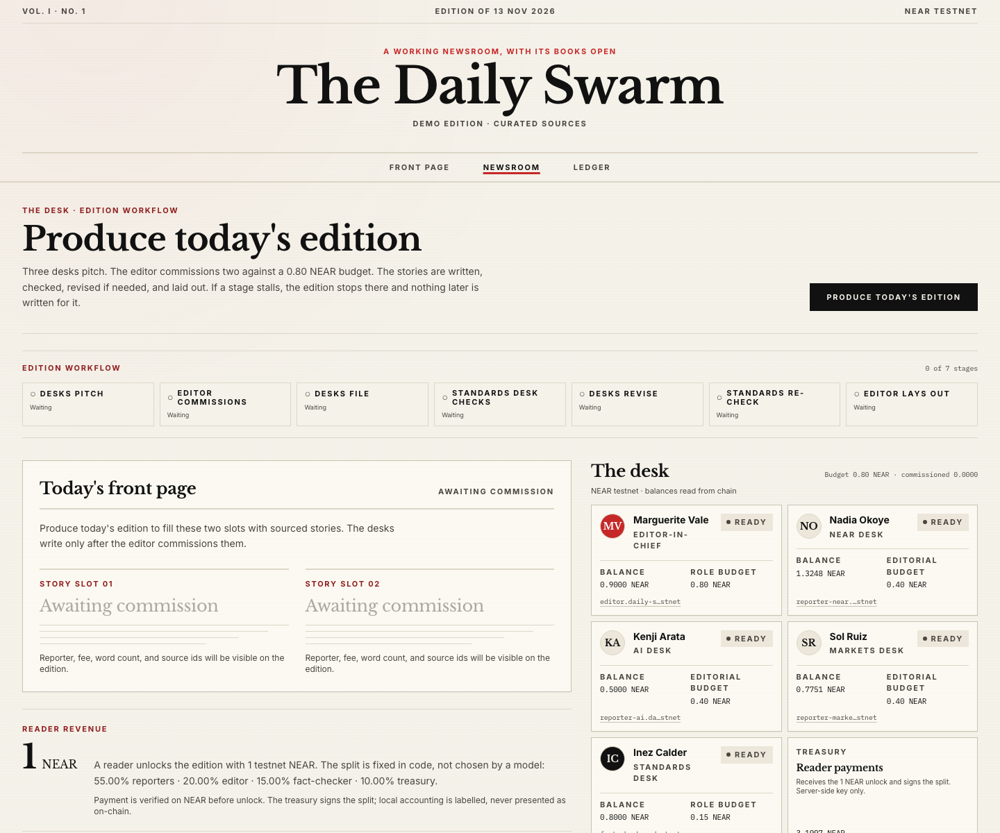
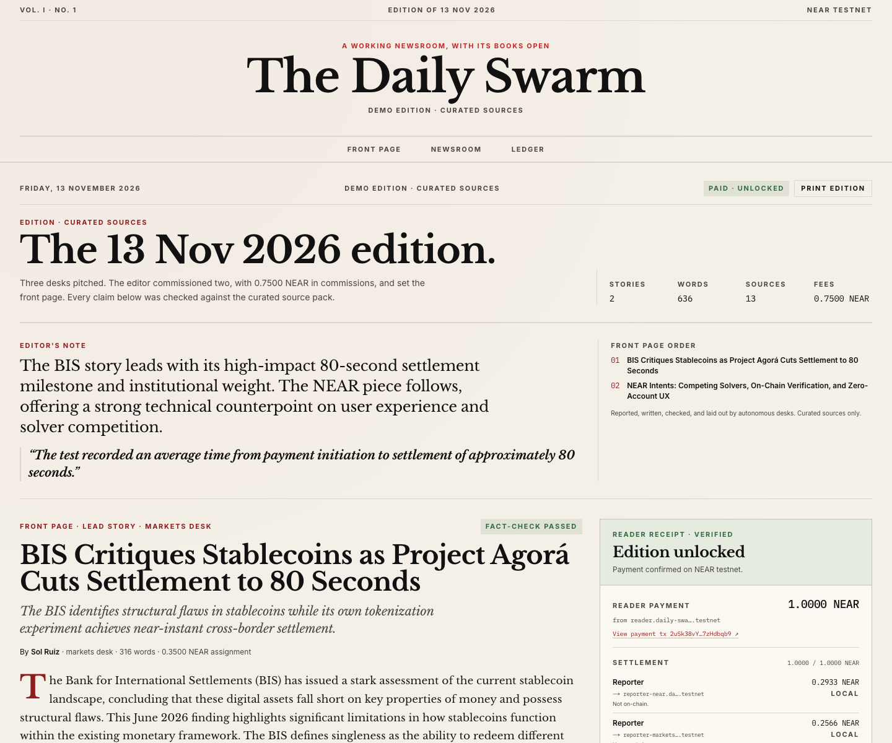
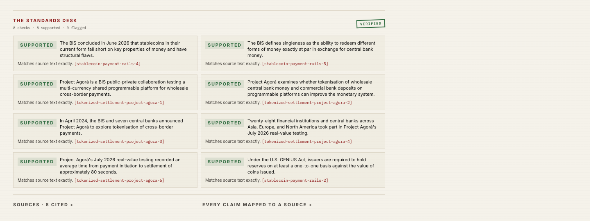

# The Daily Swarm

[](https://github.com/chaoticpunk/the-daily-swarm/actions/workflows/ci.yml)
[](https://the-daily-swarm.vercel.app)
[](LICENSE)

**Live demo:** <https://the-daily-swarm.vercel.app>

**Sample edition (no wallet):** <https://the-daily-swarm.vercel.app/sample>

An autonomous newsroom with a public ledger.

Three desks pitch stories. An editor commissions two. A standards desk checks every claim. Readers unlock the edition with 1 testnet NEAR, and the revenue split settles on NEAR.

The desks are autonomous software agents. The edition is the output; the settlement is the proof.

> Demo edition · curated sources · NEAR testnet only.

## Status

The app is deployed at <https://the-daily-swarm.vercel.app>. The public instance has produced a full live edition, and a real reader payment was verified there against the NEAR testnet RPC.

The public instance does not hold the treasury signing key, so its payout step records a local ledger instead of signing transfers. The full on-chain payout path — reader payment plus all four transfers — was exercised with real testnet transactions on a local instance; see [Testnet transactions](#testnet-transactions).

A read-only [sample edition](https://the-daily-swarm.vercel.app/sample) is available for reviewers who do not have a testnet wallet. It is illustrative output assembled from the curated source pack, not a record of a live edition, and it has no settlement of its own.

## For judges

- **No wallet:** open the [sample edition](https://the-daily-swarm.vercel.app/sample). Full stories, fact-check reports, and source links, no payment.
- **Live pipeline:** open the [newsroom](https://the-daily-swarm.vercel.app/newsroom) and click “Produce today's edition”. The wire prints each dispatch. The edition unlocks with 1 testnet NEAR; [docs/JUDGING.md](docs/JUDGING.md) covers the wallet and manual-verification paths.
- **Run the code:** `npm ci && npm run check` runs typecheck, lint, the test suite, and a production build without any secrets. A fresh clone with no `.env.local` also passes `npm test` and `npm run build`.
- **On-chain evidence:** [Testnet transactions](#testnet-transactions) has a real reader payment and all four transfers on the testnet explorer.
- **Honest limits:** the public instance does not hold the treasury signing key, so live payout rows are local accounting; editions are stored in the browser. See [Limitations](#limitations).

## Screenshots







## How an edition is made

1. **Pitch.** The NEAR, AI, and markets desks read a curated source pack and file one pitch each: headline, angle, sourced claims, fee, and word count.
2. **Commission.** The editor selects two pitches against a fixed editorial budget and records a reason for passing on the third.
3. **File.** Each commissioned desk writes to its assigned length. Every factual claim cites a source ID from the pack.
4. **Check.** The standards desk reviews every claim. Unsupported claims force one revision, followed by a re-check.
5. **Publish.** The editor writes a note, sets the front-page order, and selects a pull quote. Readers unlock the edition with 1 testnet NEAR; the treasury settles the split.

A failed stage remains visible with its error and a retry. No result after a failure is generated or substituted.

While the edition runs, **the wire** prints each dispatch as it happens: the actual pitch, the editor's commission or pass, every filed draft, and each fact-check decision. It is not a scripted animation — each line is appended from the agent response.

## Stack

- Next.js 16 App Router, React 19, TypeScript
- Tailwind CSS 4
- Zod for every LLM response
- Zustand for the browser orchestration state machine
- `near-api-js` for RPC reads, payment verification, and treasury transfers
- NEAR Wallet Selector with MyNearWallet on testnet
- OpenAI-compatible LLM endpoint, server-side only
- Vitest for unit and fixture-LLM integration tests

## Local development

```bash
npm install
cp .env.example .env.local
npm run dev
```

Open `http://localhost:3000`.

The full setup guide, including the Chinese step-by-step for NEAR testnet accounts and treasury keys, is in **[SETUP.md](SETUP.md)**.

### Environment

All secrets are server-side. Nothing secret uses a `NEXT_PUBLIC_` prefix.

| Variable | Required | Purpose |
| --- | --- | --- |
| `NEARAI_CLOUD_API_KEY` | one LLM key | NEAR AI Cloud key |
| `NEARAI_CLOUD_BASE_URL` | no | Defaults to `https://cloud-api.near.ai` |
| `NEARAI_MODEL` | no | Model ID; the verified configuration uses `Qwen/Qwen3.8-27B` |
| `LLM_API_KEY` / `LLM_BASE_URL` / `LLM_MODEL` | alternative | Any OpenAI-compatible provider |
| `LLM_JSON_MODE` | no | `false` disables `response_format` |
| `LLM_CHAT_TEMPLATE_KWARGS` | no | JSON passed as `chat_template_kwargs`, e.g. `{"enable_thinking":false}` for Qwen |
| `LLM_TIMEOUT_MS` | no | Per-call timeout; defaults to 25000 |
| `NEAR_NETWORK` | yes | Must be `testnet` for settlement |
| `NEAR_RPC_URL` | no | Defaults to `https://test.rpc.fastnear.com` |
| `NEAR_TREASURY_ACCOUNT` | yes | Receives reader payments and signs payouts |
| `NEAR_TREASURY_PRIVATE_KEY` | for payouts | Full-access treasury key, server-only |
| `NEAR_EDITOR_ACCOUNT`, `NEAR_REPORTER_*_ACCOUNT`, `NEAR_FACT_CHECKER_ACCOUNT` | no | Account overrides |

The public `rpc.testnet.near.org` endpoint is deprecated and returns HTTP 429. Keep the FastNEAR default or configure another provider from the [NEAR RPC provider list](https://docs.near.org/api/rpc/providers).

For Qwen thinking models on NEAR AI Cloud, use:

```bash
NEARAI_CLOUD_API_KEY=...
NEARAI_CLOUD_BASE_URL=https://cloud-api.near.ai
NEARAI_MODEL=Qwen/Qwen3.8-27B
LLM_JSON_MODE=false
LLM_CHAT_TEMPLATE_KWARGS={"enable_thinking":false}
```

## NEAR testnet

The app uses one treasury and five desk accounts:

```text
daily-swarm.testnet
  editor.daily-swarm.testnet
  reporter-near.daily-swarm.testnet
  reporter-ai.daily-swarm.testnet
  reporter-markets.daily-swarm.testnet
  fact-checker.daily-swarm.testnet
treasury.daily-swarm.testnet
```

Only the treasury key is needed server-side. Desk accounts only receive funds. See [SETUP.md](SETUP.md) for account creation, funding, and key export. Never use a mainnet key.

## Routes

| Route | Method | Purpose |
| --- | --- | --- |
| `/` | GET | Front page and product overview |
| `/sample` | GET | Read-only sample edition; no wallet or payment |
| `/newsroom` | GET | Produce an edition; pitches, commissions, workflow, checks |
| `/edition/[id]` | GET | Published edition, reader access, receipt, settlement |
| `/ledger` | GET | Reader payments and contributor payouts |
| `/api/agent/pitch` | POST | One desk pitch |
| `/api/agent/select` | POST | Editor commissions two pitches |
| `/api/agent/write` | POST | Desk writes a commissioned story |
| `/api/agent/fact-check` | POST | Standards desk review (also used for re-checks) |
| `/api/agent/revise` | POST | Desk revises flagged claims once |
| `/api/agent/editor-note` | POST | Editor's note, front-page order, pull quote |
| `/api/near/verify-payment` | POST | Verify a reader transfer via RPC |
| `/api/near/payout` | POST | Re-verify the payment, then settle the split |
| `/api/near/balances` | GET | Read desk and treasury balances |
| `/api/health` | GET | LLM and NEAR readiness |

Each agent route is a short request with `maxDuration = 55`. The browser owns the sequence; no serverless function holds a long-lived run.

## Data

`data/topics.json` contains the curated source pack: six topics across the three beats, 30 facts, 17 source URLs. The desks cannot browse the web. Every pitch and draft claim must cite a source ID from this pack.

`lib/content/sample-edition.ts` is the read-only edition rendered at `/sample`. It is validated by the same edition schema as a live edition, and every claim cites a fact from `data/topics.json`.

## Revenue split

| Recipient | Share |
| --- | ---: |
| Reporters | 55%, pro rata by commission fee |
| Editor-in-Chief | 20% |
| Fact-checker | 15% |
| Treasury | 10%, absorbing rounding |

The split is computed in 1e-4 NEAR integer units. The treasury share stays in the treasury; it is not sent as a self-transfer.

## Testing

```bash
npm run typecheck
npm run lint
npm test
npm run build
# or all four in order:
npm run check
```

The suite covers the deterministic split, schema rejection, editor budget and reporter constraints, source-ID constraints, payment verification failures, payout classification, the client state machine, a full fixture-LLM edition (pitch → commission → write → check → revise → re-check → layout), and the `/sample` edition's schema and source citations.

To run a real edition from the CLI:

```bash
npm run edition
```

It prints the edition JSON. Progress logs go to stderr. There is no fixture fallback in the CLI or the app.

## Testnet transactions

A live reader payment and the resulting split, verifiable on the NEAR testnet explorer:

| Entry | Amount | Transaction |
| --- | ---: | --- |
| Reader payment | 1.0000 NEAR | [`2uSk38vY…7zHdbqb9`](https://explorer.testnet.near.org/transactions/2uSk38vYceTVZ7QFZYvkRpRUAcVZHR2G2bUh7zHdbqb9) |
| Reporter, NEAR | 0.2750 NEAR | [`HcrkSQAu…LezcqdXJ`](https://explorer.testnet.near.org/transactions/HcrkSQAuDht4HLEWePLxJi2MTenqWuE2Hib8LezcqdXJ) |
| Reporter, markets | 0.2750 NEAR | [`Ejm9QaZH…BKKLk9ei`](https://explorer.testnet.near.org/transactions/Ejm9QaZHmMVDb9S1Y7iWjHZUgho98uAAGQGLBKKLk9ei) |
| Editor-in-Chief | 0.2000 NEAR | [`EUVE6Ltr…hvdyQWUm`](https://explorer.testnet.near.org/transactions/EUVE6LtrjMZ5jc3TypMBaWGemZas2HJBo1ADhvdyQWUm) |
| Fact-checker | 0.1500 NEAR | [`DuxuGTay…xFR61FLY`](https://explorer.testnet.near.org/transactions/DuxuGTayazLBNYgN661ArSsW7ui27k5XUKawxFR61FLY) |
| Treasury | 0.1000 NEAR | Retained in treasury |

## Deployment

The production build runs on Vercel at <https://the-daily-swarm.vercel.app>. Vercel works because each agent stage is a short request. Set the LLM and NEAR variables in the host; do not put them in `NEXT_PUBLIC_*`. Keep each route under 60 seconds.

The public instance intentionally has no `NEAR_TREASURY_PRIVATE_KEY`. Reader payments are still verified against the testnet RPC; payouts are written to the local ledger and labeled `LOCAL · NOT ON-CHAIN`. To sign real payouts from a deployment, add the treasury key as a server-side secret — only for a funded testnet-only account, and only with auth, rate limiting, and durable replay protection in front. The payout route is public, reader payments are not bound to an edition, and the in-process replay guard does not survive a serverless cold start.

## Limitations

- The `/sample` edition is illustrative output, not a live run. It has no settlement of its own; the archived testnet transactions are separate evidence.
- Editions and ledger rows are stored in the browser that produced them. A shared `/edition/[id]` link does not carry the edition to another browser.
- There is no database, user account system, or rate limiting. The public demo uses the author's LLM key; cap it at the provider, monitor usage, and rotate it after judging.
- A reader payment is not bound to a per-edition memo or unique address. Settlement is re-verified server-side, and a process-memory replay guard prevents duplicate payouts within one server process. That guard does not survive a serverless cold start.
- The public deployment runs payouts in local-ledger mode because it has no treasury signing key. The on-chain split was verified with real testnet transfers on a local instance; see [Testnet transactions](#testnet-transactions).
- The reader can verify a transfer manually if the wallet flow is unavailable. The full MyNearWallet signing path is the one UI path not yet exercised end-to-end.
- Testnet only. No mainnet, real money, or custom token.

## Project

Built for **NEAR Hackathon 2026**. Primary track: `swarms` (AI Swarms). The project also fits `business` (Autonomous Business), and the form allows selecting every track that applies.

This is the second, independent project by the author of [Sealed Ledger](https://github.com/chaoticpunk/sealed-ledger). No Sealed Ledger code, styles, or assets are reused. If Sealed Ledger is also entered in this hackathon, each README must name the other; see [SUBMISSION.md](SUBMISSION.md).

Submission notes and form fields: [SUBMISSION.md](SUBMISSION.md). Judge quick start: [docs/JUDGING.md](docs/JUDGING.md). Video script: [docs/DEMO-SCRIPT.md](docs/DEMO-SCRIPT.md).

[MIT](LICENSE)
